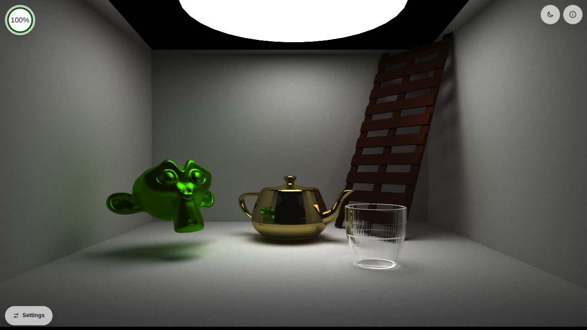
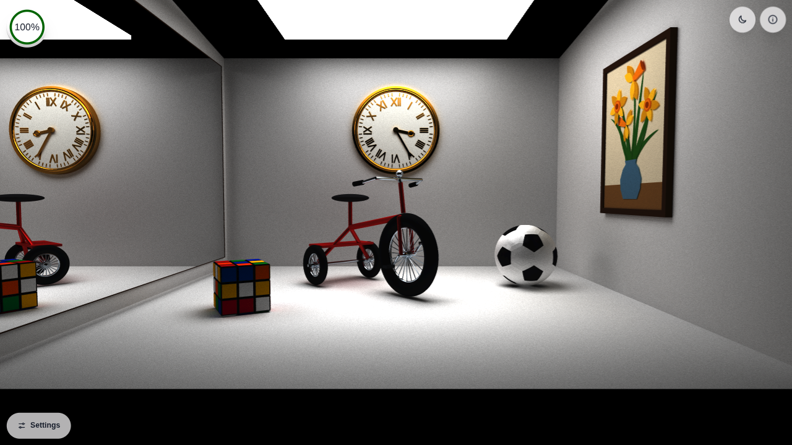

# WebGL Ray Tracer

A path tracer that runs entirely in your browser. The GPU does the tracing in a WebGL 2 fragment shader, and the image sharpens as more samples arrive. You can orbit the camera while it renders, change the settings live, and switch the UI between light and dark mode.

Live at [https://webgl-ray-tracer.orky.net](https://webgl-ray-tracer.orky.net).

## 1. Pre-rendered examples

Each render is 1280 by 720 with 4000 samples per pixel, and the settings card and the progress readout are collapsed.

Original scene, 45° field of view, 8 bounces.



Newer scene, 50° field of view, 8 bounces.



## 2. What you need

- A browser that supports WebGL 2 and the `EXT_color_buffer_float` and `EXT_float_blend` extensions. Recent versions of Chrome, Firefox and Safari all qualify.
- A reasonably powerful GPU. A desktop card such as an Nvidia GeForce GTX 1080 converges in seconds to minutes. Phones work too, in portrait and landscape, but render at half the width and height and take longer.
- If hardware or software support is missing, the page says what instead of showing a blank view.

## 3. Using it

| Action | Mouse                | Touch       |
| ------ | -------------------- | ----------- |
| Rotate | Left-drag            | One finger  |
| Pan    | Right-drag           | Two fingers |
| Zoom   | Wheel or middle-drag | Pinch       |

- **Progress** is tracked by the ring in the top left corner, with the sample count, elapsed time, time remaining and the average time per sample beside it. The render starts over from zero samples whenever the camera, a setting or the window size changes.
- **Render settings** are in the card at the bottom left, and the chevron collapses it out of the way. They are the scene, field of view, samples per pixel, ray bounces, and Flat or Phong shading.
- The buttons at the top right switch the theme and open the About card that lists these controls and the MIT license.

## 4. Running it locally

You need Node.js and [pnpm](https://pnpm.io).

```sh
pnpm install
pnpm dev
```

Then open the address Vite prints. [`RUNBOOK.md`](RUNBOOK.md) covers the other commands, checking a render and deploying.

## 5. Your own scene

The thumbnails in the settings card pick one of the bundled glTF 2.0 scenes, and the "Open .glb" card loads a `.glb` file from your own drive. The file is read in the browser and never uploaded. It must be a self-contained `.glb` whose materials use plain PBR factors, because textures are ignored. [Rendering gotchas](AGENTS.md#3-rendering-gotchas) in [`AGENTS.md`](AGENTS.md) lists how each material field is read.

## 6. How it started

I went to Eric Haines's GDC 2019 talk, "A Fast Forward Through [Ray Tracing Gems](http://www.realtimerendering.com/raytracinggems)", where real-time ray tracing was the hot topic. Peter Shirley's [Ray Tracing in One Weekend](http://in1weekend.blogspot.com/2016/01/ray-tracing-in-one-weekend.html) came up in passing. Inspired by it, I wanted to see whether a ray tracer could run on the web, using the GPU through a fragment shader, which suits tracing rays in parallel almost perfectly.

What I ended up with is a path tracer, which averages many random rays per pixel so the image sharpens as it converges. [Rendering approach](ARCHITECTURE.md#1-rendering-approach) says why, and [Rendering pipeline](ARCHITECTURE.md#2-rendering-pipeline) and [Scene loading & BVH](ARCHITECTURE.md#3-scene-loading--bvh) follow a frame from the glTF file to the screen.

[`AGENTS.md`](AGENTS.md) lists the gotchas and conventions for working on the code.

## 7. License

[MIT](LICENSE). Copyright © 2026 Kam Y Yip.

Enjoy!

Kam
